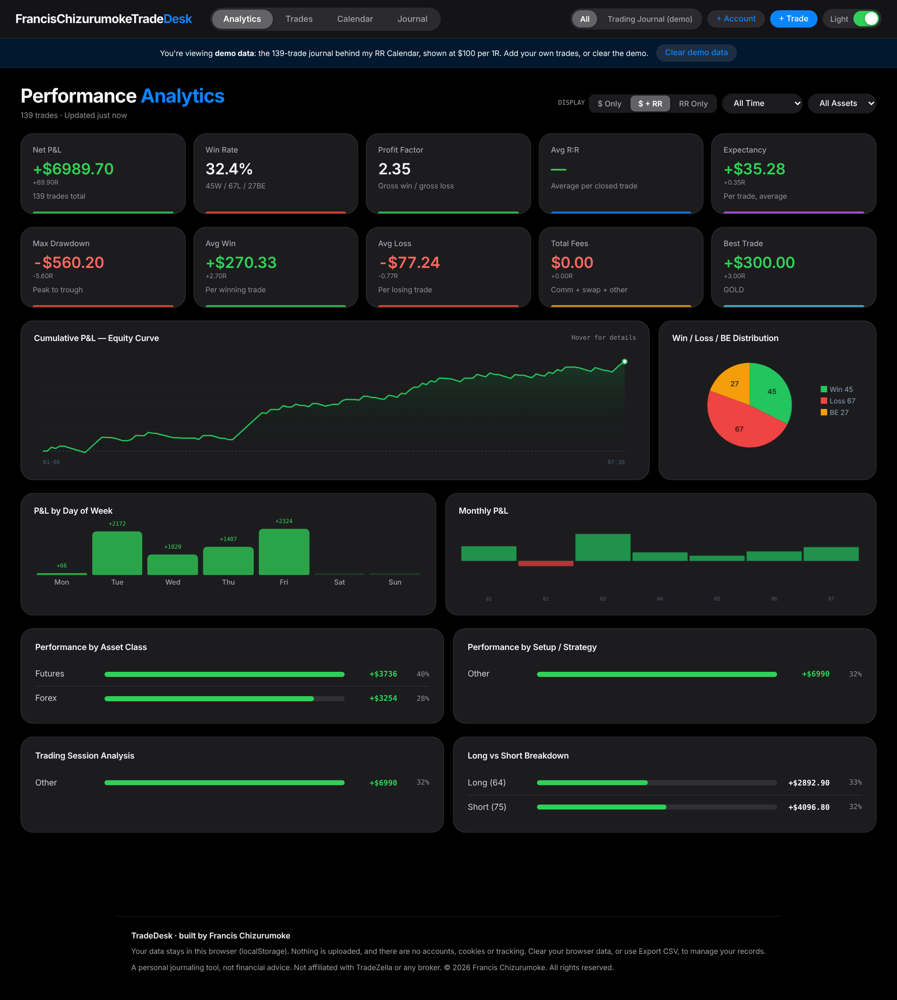
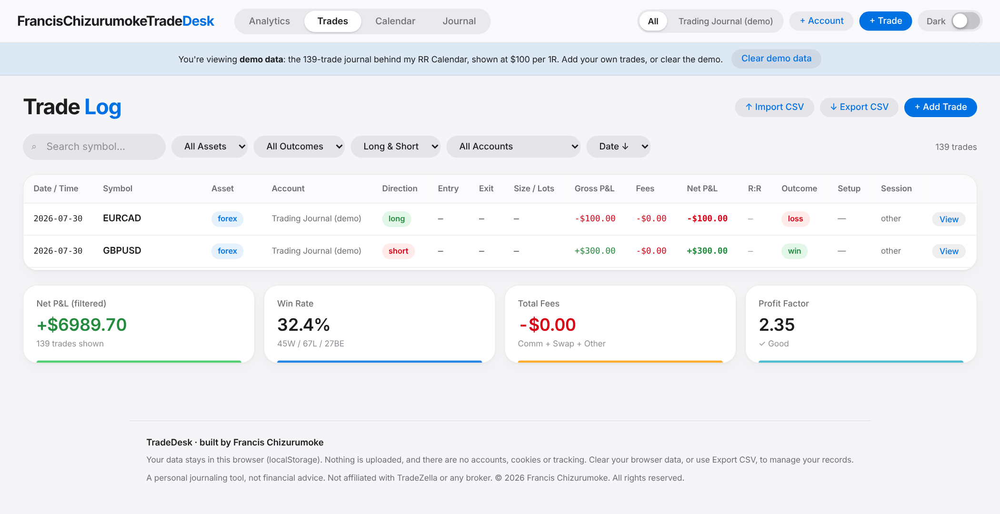

# TradeDesk — Free Trading Journal

A free, browser-based trading journal for recording trades, reviewing performance and keeping trading notes. It runs from a single HTML file, requires no account or server, and stores journal data locally in the browser.

**Live demo:** [Open TradeDesk](https://francisos1234.github.io/Trade-desk-Free-Trading-Journal/)  
**Source code:** [View this repository](https://github.com/Francisos1234/Trade-desk-Free-Trading-Journal)

> Built by **Francis Chizurumoke** with AI-assisted coding (ChatGPT and Claude). My contribution includes product direction, workflow and feature specification, and testing against my own trading records.

## Project overview

TradeDesk is designed to bring the core parts of a trading journal into one place: trade records, performance analytics, a P&L calendar and written journal entries. It is intended for traders who want a practical way to review their activity without paying for a subscription or sending their records to an external journaling service.

The application is delivered as a single HTML file. It does not require a backend, user account or broker connection.

## The problem

I wanted a straightforward journaling tool that could bring trade tracking and performance review together while keeping the data under the user's control. Many journaling platforms offer extensive paid features, but not every trader needs broker integrations or advanced review tools to maintain a consistent record of their decisions.

TradeDesk focuses on the essential workflow: record trades, organise them, review the numbers and reflect on the process.

## What I built

- **Performance analytics:** net and gross P&L, win rate, profit factor, average win and loss, average R:R, expectancy, fees, max drawdown and equity curve.
- **Flexible performance display:** view results in dollars, R-multiples or both.
- **Trade log:** add, view, edit and delete trades, including entry and exit prices, position size, fees, setup, session, tags and notes.
- **P&L calendar:** review daily and monthly results, with a daily breakdown and weekly summaries.
- **Trading journal:** record session reflections, mindset, mistakes and tags.
- **Multiple accounts:** separate personal and prop firm accounts, with account-level filtering.
- **Risk-rule tracking:** set daily loss, maximum drawdown and trades-per-day limits.
- **CSV import and export:** import supported broker exports and export records for backup or further analysis.
- **Filters and themes:** filter records by relevant fields and switch between light and dark themes.

## Tools and technology

- HTML, CSS and JavaScript
- Browser `localStorage` for local data persistence
- CSV import and export
- GitHub for source control and project documentation
- Notion and Microsoft Excel as part of my separate manual trade-recording and analysis workflow

## How the demo data was prepared

The default demo in the app is based on a trade sample I collected manually, rather than randomly generated example trades. I record trades in a Notion journal and use Microsoft Excel to organise and analyse the exported records. A view-only Google Sheets copy of the workbook is also available.

The demo uses the recorded R-multiple sample and displays dollar P&L using a fixed **$100 per 1R** conversion under the 3R outcome model. This is an illustrative display of that sample, not a live broker feed or an automatic connection to Notion or Excel.

For the underlying journal, analysis process, validation and supporting evidence, see the [Trading Performance Analysis Portfolio — Interactive RR Calendar](https://github.com/Francisos1234/Trading-performance-journal).

## Screenshots

The screenshots below show the application interface and its main areas.

| Analytics — light theme | Analytics — dark theme |
| --- | --- |
|  |  |

| P&L calendar | Trade log |
| --- | --- |
|  |  |

## Privacy and data handling

Trade records and journal entries are stored in the browser's `localStorage` on the device and browser where they were entered. The app does not upload journal data to a server and does not require an account.

This also means that browser storage is not a cloud backup. Export your records regularly using **Export CSV**. Clearing browser data or using a different browser or device may make locally stored records unavailable.

## Limitations

- There is no automatic broker synchronisation.
- There is no cloud account or cross-device data synchronisation.
- Trade replay, backtesting and automated AI reviews are not included.
- CSV imports depend on the supported column format and the structure of the broker export.
- The demo data is a manually collected sample for demonstrating the application. It should not be interpreted as a promise of future trading results.

## Related project and verification

TradeDesk is the journaling application. The companion [Trading Performance Analysis Portfolio](https://github.com/Francisos1234/Trading-performance-journal) documents the manually collected trade sample and the analysis behind the R-multiple performance views. It includes the supporting Notion journal, Excel workbook, validation checks and interactive RR calendar.

- [View the Trading Performance Analysis Portfolio](https://github.com/Francisos1234/Trading-performance-journal)
- [Open the Notion trading journal](https://keen-aphid-255.notion.site/1d6b72eefb448311bc0881252fd9eff1?v=351b72eefb448242bc4708990c24df04)
- [View the Excel analysis workbook (Google Sheets, view only)](https://docs.google.com/spreadsheets/d/1Zb0AqxhuoKOI4FfsY-HOJ8ML6g8eN37X/edit?usp=sharing)

## Disclaimer

TradeDesk is a personal journaling and record-keeping tool. It is not financial advice, does not provide trading signals and does not guarantee trading performance. The demo sample is historical and does not predict future results.

## Copyright

© 2026 Francis Chizurumoke. All rights reserved. This repository is public for viewing and evaluation only. See [LICENSE](LICENSE).
