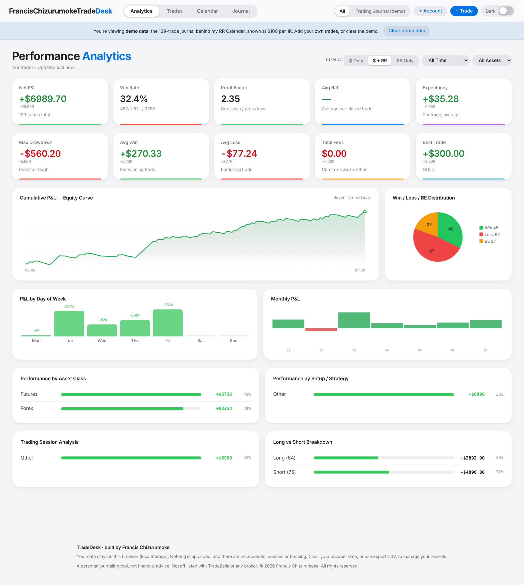
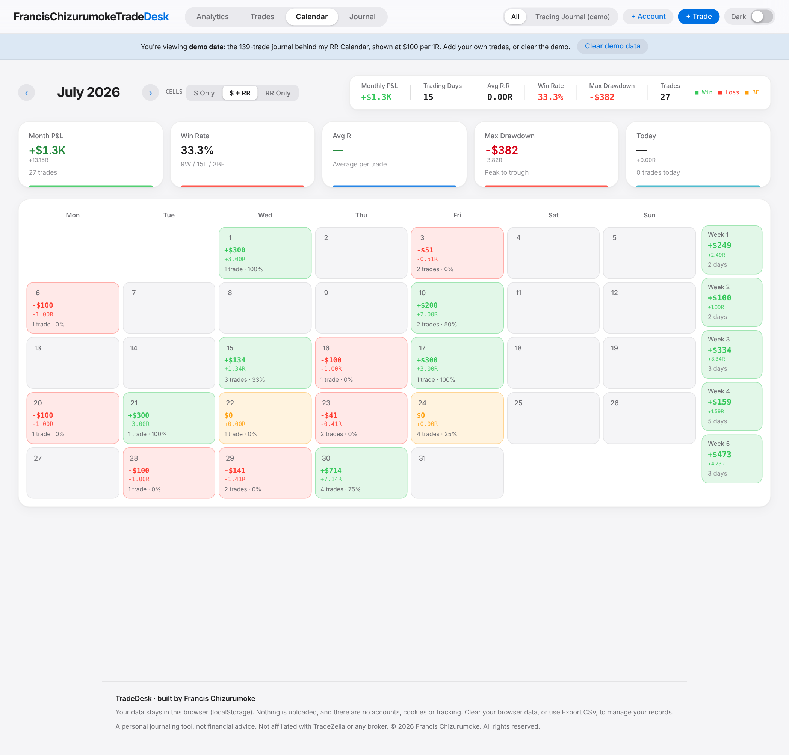

# TradeDesk — Free Trading Journal

A free, browser-based trading journal I built to record trades, review performance and keep trading notes in one place. It runs as a standalone HTML application, requires no account or backend, and stores user-entered journal data locally in the browser.

**Live demo:** [Open TradeDesk](https://francisos1234.github.io/Trade-desk-Free-Trading-Journal/)  
**GitHub repository:** [Francisos1234/Trade-desk-Free-Trading-Journal](https://github.com/Francisos1234/Trade-desk-Free-Trading-Journal)

Built by **Francis Chizurumoke**, with AI-assisted coding using ChatGPT and Claude.

---

## Project overview

TradeDesk brings together the main parts of a trading journal: trade recording, performance analytics, a P&L calendar and daily journal entries.

I wanted a practical tool that could help traders keep their records organised and review their performance without requiring a paid subscription, broker connection or online account.

The application is a single HTML file using browser storage. It includes a clearly labelled demo dataset on first load so visitors can explore the interface before entering their own records.

## The problem I wanted to solve

A trade journal is useful only when it is practical to maintain and easy to review. A list of trades can preserve what happened, but it does not always make it easy to see the bigger picture: how performance changes over time, how much was gained or lost, what drawdown looked like, or what was happening around a particular trading day.

I wanted to bring the record-keeping and review process into one lightweight application. The focus was on the core journaling workflow rather than trying to reproduce every feature offered by large paid platforms.

## My contribution

This is my own project. I defined the product direction and the workflow I wanted the application to support.

My contribution included:

- Identifying the problem and defining the purpose of the journal.
- Planning the main sections: analytics, calendar, trade log and daily journal.
- Specifying the information to capture when recording a trade, including account, instrument, direction, prices, size, P&L and fees.
- Defining the performance metrics and the ways users should be able to filter and review their records.
- Planning account separation and basic risk-rule tracking.
- Defining the CSV import and export workflow.
- Providing the manually collected trading sample used for the default demo.
- Reviewing the interface, testing the main workflows and checking that the application behaved as intended.
- Preparing the project documentation and screenshots.

I used ChatGPT and Claude as coding assistants during development. They supported implementation, but the project idea, requirements, workflow decisions, demo-data source and review process came from me.

## Tools and technology

| Tool | How I used it |
| --- | --- |
| HTML, CSS and JavaScript | Building the browser-based trading journal and its interface |
| Browser `localStorage` | Saving journal records locally in the user's browser |
| CSV | Importing supported broker exports and exporting journal records |
| Notion | Manually recording my own trades and their R-multiple outcomes; this is also the source journal for the demo sample |
| Microsoft Excel | Cleaning, organising, summarising and analysing the exported trade records |
| Google Sheets | Providing a view-only online copy of the Excel analysis workbook |
| ChatGPT and Claude | AI-assisted coding and development support |
| GitHub and GitHub Pages | Source control, documentation and hosting the live demo |

**Important distinction:** Notion, Excel and Google Sheets are part of my separate manual data collection and analysis workflow. TradeDesk does not automatically connect to or synchronise with those tools.

## Methodology

I approached the project in two connected parts: first, defining and building the journaling workflow; second, preparing the manually collected sample used to demonstrate the application.

### 1. Define the journaling workflow

I planned the application around four main areas:

- **Analytics:** a summary of trading performance and key metrics.
- **Calendar:** a time-based view of daily and monthly P&L, including day-level details.
- **Trade log:** a place to add, inspect, edit and remove individual trade records.
- **Daily journal:** a place to write reflections and notes about trading sessions.

I also included multiple accounts, CSV import and export, and basic risk-rule tracking so the journal could support more than simply listing completed trades.

### 2. Define the trade information and review metrics

The trade form captures details such as date, instrument, direction, entry and exit prices, position size, account, P&L and trading costs. Users can also add setup information, tags and notes.

The analytics section is designed to summarise the recorded trades through measures such as:

- Net and gross P&L.
- Wins, losses and break-even trades.
- Win rate and profit factor.
- Average win and average loss.
- Average reward-to-risk and expectancy.
- Fees and maximum drawdown.
- Equity curve and performance breakdowns.

The application can display results in dollar values, R-multiples or both, depending on the available trade information and selected display settings.

### 3. Plan the supporting features

I added features around the main record-and-review workflow:

- Multiple accounts, so records can be separated by account.
- Account and period filters for reviewing subsets of the journal.
- A P&L calendar with daily details and weekly summaries.
- Daily journal entries for reflections and lessons.
- CSV import to bring in supported broker exports.
- CSV export to keep an external copy of recorded data.
- Light and dark themes.
- Basic risk-rule tracking for daily loss, maximum drawdown and trades-per-day limits.

### 4. Collect the demo sample manually

The default demo data is not randomly generated. It comes from a sample of my own trading records that I collected manually.

My source records are maintained in a Notion trading journal, where I record trade outcomes in R-multiples. The sample behind the demo is the same 139-trade journal used in my companion [Trading Performance Analysis Portfolio.](https://github.com/Francisos1234/Trading-performance-journal)

### 5. Prepare and analyse the sample

I export the Notion journal to CSV and use Microsoft Excel to clean, organise, summarise and analyse the records. The workbook contains a Method & QA sheet with checks such as trade count, sequence continuity, reconciliation to journal totals, group totals and drawdown.

A view-only Google Sheets copy is available for people who want to inspect the workbook online. The spreadsheet work is performed in Excel; the Google Sheets copy is provided for convenient viewing.

### 6. Prepare the demo display

The source journal records results in R-multiples. For the TradeDesk demo, the sample is displayed using a fixed conversion of **$100 per 1R** under the **3R outcome model**.

This makes it possible to explore the journal interface using a familiar dollar P&L display. It is an illustrative representation of the manually collected sample, not a live broker connection, an automatic Notion import or a claim about future performance.

### 7. Implement and review the application

I used AI coding assistants to help implement the specified interface and functionality in HTML, CSS and JavaScript.

I then reviewed the application in the browser, including the main pages, trade entry, account handling, CSV workflow, filters, themes and demo-data experience. This was manual product testing, not an independent software audit or a formal verification of every possible input and broker CSV format.

## Results and demo dataset

The default demo is based on **139 manually recorded trades** from the journal used in my Trading Performance Analysis Portfolio.

The demo displays the 3R outcome model and converts R to illustrative dollar P&L at **$100 per 1R**. The sample is included so visitors can explore the analytics, calendar and trade details without first entering their own trades.

The demo is historical and represents a particular recorded sample. It is not a live account, independently audited broker statement or indication of what another trader should expect.

For the underlying records, analysis, QA checks and R-multiple dashboard, see the companion project:

**[Trading Performance Analysis Portfolio — Interactive R-Multiple Dashboard](https://github.com/Francisos1234/Trading-performance-journal)**

## Validation and testing

I reviewed the application through manual use and checked the main workflows against the requirements I had defined.

My checks included:

1. Opening the live application and reviewing the initial demo experience.
2. Navigating between analytics, calendar and journal sections.
3. Adding and managing trade records.
4. Reviewing account selection and filtering.
5. Testing the CSV import and export workflow with supported file structures.
6. Checking the performance summaries and calendar views as the underlying records changed.
7. Switching between light and dark themes.
8. Checking the demo-data clearing workflow.

For the manually collected sample itself, the companion Excel workbook includes the Method & QA checks used to review trade count, sequence continuity, totals, group summaries and drawdown.

These are practical checks performed as part of my workflow. They should not be described as an independent audit of the trading data or a comprehensive software security and correctness assessment.

## Limitations

There are important boundaries to what TradeDesk does:

1. **Local browser storage:** Trade records are stored in the browser's `localStorage`. They are not automatically backed up to the cloud.
2. **No automatic broker synchronisation:** Users can import supported CSV files, but the application does not connect directly to a broker.
3. **No automatic Notion or spreadsheet connection:** My own Notion, Excel and Google Sheets workflow is separate from the application.
4. **No cross-device account:** Data stored in one browser is not automatically available on another device or browser.
5. **CSV compatibility:** Imports depend on the structure of the file and the column formats supported by the importer.
6. **Demo is a fixed sample:** The default sample is provided for demonstration. It is not continuously updated from my Notion journal.
7. **Not a trade execution platform:** TradeDesk records and reviews information; it does not place, manage or execute trades.
8. **Not financial advice:** The analytics describe recorded data and do not predict or guarantee future trading results.

Because data is stored locally, users should export their records regularly. Clearing browser data may remove locally stored journal information.

## Evidence and project links

### Live application and source

- **[Open the TradeDesk live demo](https://francisos1234.github.io/Trade-desk-Free-Trading-Journal/)**
- **[View the GitHub repository and source code](https://github.com/Francisos1234/Trade-desk-Free-Trading-Journal)**

### Application screenshots

#### 1. Performance analytics — light theme

#### 2. Performance analytics — dark theme

#### 3. P&L calendar

#### 4. Trade log

### Underlying data collection and analysis

The following companion project provides the evidence behind the manually collected demo sample and its R-multiple analysis.

- **[Trading Performance Analysis Portfolio — GitHub](https://github.com/Francisos1234/Trading-performance-journal)**
- **[Notion trading journal](https://keen-aphid-255.notion.site/1d6b72eefb448311bc0881252fd9eff1?v=351b72eefb448242bc4708990c24df04)**
- **[Excel analysis workbook — Google Sheets view-only copy](https://docs.google.com/spreadsheets/d/1Zb0AqxhuoKOI4FfsY-HOJ8ML6g8eN37X/edit?usp=sharing)**

The companion portfolio explains how I collect the trades in Notion, export the journal to CSV, prepare and validate the data in Excel, and visualise the results in the separate R-multiple dashboard. It is the appropriate place to inspect the data process in detail.

## Related portfolio projects

- **[Trading Performance Analysis Portfolio](https://github.com/Francisos1234/Trading-performance-journal)** — interactive R-multiple dashboard built from my manually maintained trading journal.
- **[Trading Equity Curve Simulator](https://github.com/Francisos1234/Monte-Carlo-Simulator)** — explores possible equity paths using trading statistics and user-defined assumptions.
- **[Prop Firm Challenge Calculator](https://github.com/Francisos1234/Prop-Firm-Challenge-Calculator)** — compares challenge structures, drawdown settings, risk levels and estimated outcomes.

## Copyright and disclaimer

© 2026 Francis Chizurumoke. All rights reserved.

TradeDesk is a personal trading journal and record-keeping tool. It is provided for educational and analytical purposes only. It is not financial advice, does not provide trading signals and does not guarantee trading performance. The demo data is a manually collected historical sample and should not be interpreted as a promise or forecast of future results.
